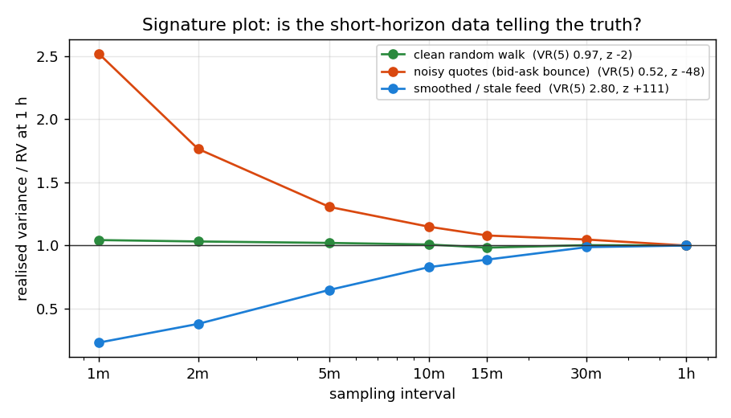
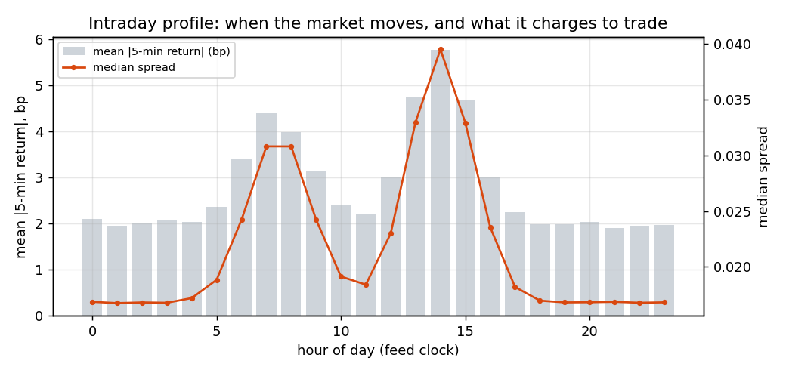
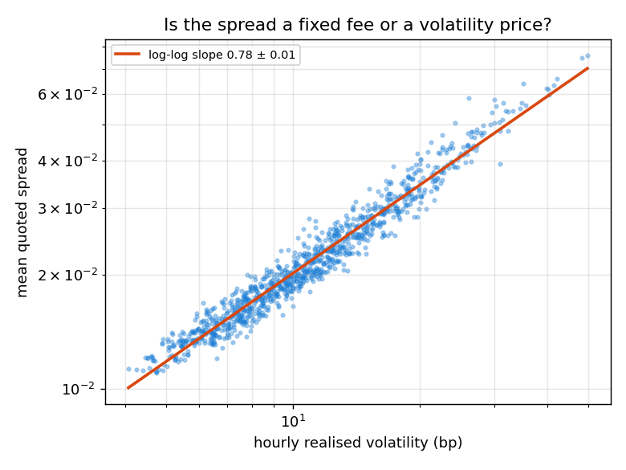

# mmdiag: check what your price feed is really telling you

[](https://github.com/Tolbert-Okoth/market-microstructure-diagnostics/actions/workflows/tests.yml)


Short-horizon strategies (scalping, intraday timing, tight stops) are only as good as the feed they were researched on. Two common feed problems mislead backtests:
- **Bid-ask bounce and noisy quotes** make prices look mean-reverting.
- **Smoothed, stale or aggregated quotes** make prices look trending.

The same instrument from two vendors can therefore produce opposite "edges".

`mmdiag` runs four quick diagnostics on any timestamped mid-price series and, optionally, its spread:
- **`signature_plot`:** realised variance against sampling interval. Flat means a random walk. Rising towards short intervals means noise; falling means smoothing or short-term momentum.
- **`variance_ratio`:** the Lo-MacKinlay VR(k) with a heteroskedasticity-robust z statistic.
- **`intraday_profile`:** volatility, update count and median spread by hour of day. It shows when the market moves and what it charges.
- **`spread_vol_elasticity`:** whether the spread is a fixed fee (elasticity ≈ 0) or a price for volatility (≈ 1, as Madhavan-Richardson-Roomans-type models predict).



## What the demo shows (three synthetic feeds of the *same* underlying price, `python examples/headline.py`)
| Feed | RV(1 min) / RV(1 h) | VR(5) | z | Reading |
|---|---|---|---|---|
| Clean random walk | 1.04 | 0.97 | −1.9 | Trustworthy at all scales |
| Noisy quotes (bid-ask bounce) | **2.52** | 0.52 | −48 | Fake mean reversion: short-horizon "reversal edges" are artefacts |
| Smoothed / stale feed | **0.23** | 2.80 | +111 | Fake momentum: short-horizon "continuation edges" are artefacts |

All three feeds share one efficient price, so any strategy whose edge differs across them is trading the feed, not the market.





**Spread versus volatility:** in the demo, the spread is part fixed and part proportional to volatility, and the elasticity comes out at **0.78 ± 0.01**. The practical reading is that trading in busy hours costs more in price units but not more per unit of risk. That is why cost should be judged in R, not in pips.

## Why I built it
- **Two feeds for the same gold contract gave opposite short-horizon results in my own research.** Order-flow imbalance looked like continuation on one vendor's ticks and reversal on the broker's own feed. The signature plots and variance ratios explained it before any strategy time was spent.
- **The same checks caught a feed whose timestamps were on a different clock than documented.** The intraday profile's activity peaks sat at the wrong hours.

## Quick start
```bash
pip install "git+https://github.com/Tolbert-Okoth/market-microstructure-diagnostics.git#egg=mmdiag[plot]"
```
```python
import pandas as pd, mmdiag as md

q = pd.read_csv("my_quotes.csv", index_col=0, parse_dates=True)      # your own data: bid, ask columns
mid, spread = (q.bid + q.ask) / 2, q.ask - q.bid

print(md.signature_plot(mid))                     # ratio_to_longest far from 1 at short intervals = feed artefacts
print(md.variance_ratio(mid, base="1min", k=5))
print(md.intraday_profile(mid, spread))
print(md.spread_vol_elasticity(mid, spread)["elasticity"])
```

## API
| Function | Returns |
|---|---|
| `signature_plot(prices, intervals)` | Mean daily realised variance per interval, and the ratio to the longest |
| `variance_ratio(prices, base, k)` | `vr` and robust `z` (Lo-MacKinlay 1988) on intraday returns |
| `intraday_profile(prices, spread, freq, by)` | Mean absolute return (bp), updates per day and median spread by hour (or minute, weekday …) |
| `spread_vol_elasticity(prices, spread, freq)` | Log-log slope of spread on realised volatility, its SE, R² and the bucket data |

Overnight and weekend gaps are dropped from intraday returns automatically.

## Who this is for
- **Traders choosing a data vendor or broker feed**, before researching a short-horizon idea on it.
- **Quant researchers:** a 30-second sanity check that belongs before every intraday backtest.
- **Teams and clients:** I offer data-feed and execution-cost audits using this toolkit. Contact via my GitHub profile.

## Data and licensing
- **No market data is included.** Every figure comes from synthetic feeds generated by `examples/headline.py`.
- Use the tools with data you are licensed to use. Nothing here downloads or redistributes vendor data.
- Code: MIT License (see `LICENSE`).

## References
- Andersen, T., Bollerslev, T., Diebold, F. & Labys, P. (2000). *Great Realizations.* Risk: the volatility signature plot.
- Lo, A. & MacKinlay, A. C. (1988). *Stock Market Prices Do Not Follow Random Walks.* Review of Financial Studies.
- Madhavan, A., Richardson, M. & Roomans, M. (1997). *Why Do Security Prices Change?* Review of Financial Studies.
- Bouchaud, J.-P., Bonart, J., Donier, J. & Gould, M. (2018). *Trades, Quotes and Prices.* Cambridge University Press.

## Disclaimer
Research and educational software. Not investment advice, and no warranty: see `LICENSE`.
